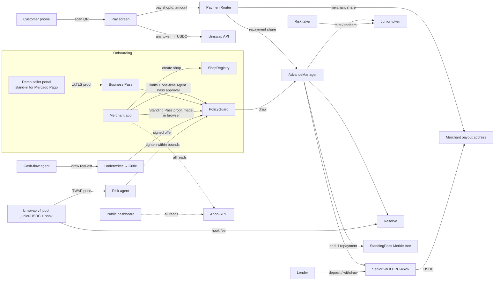
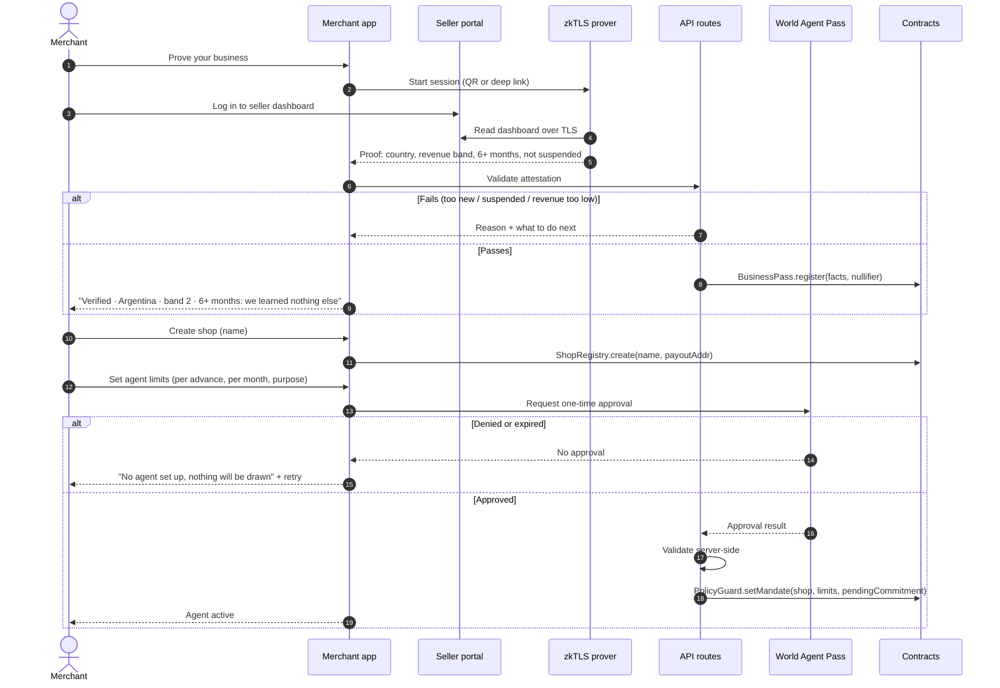
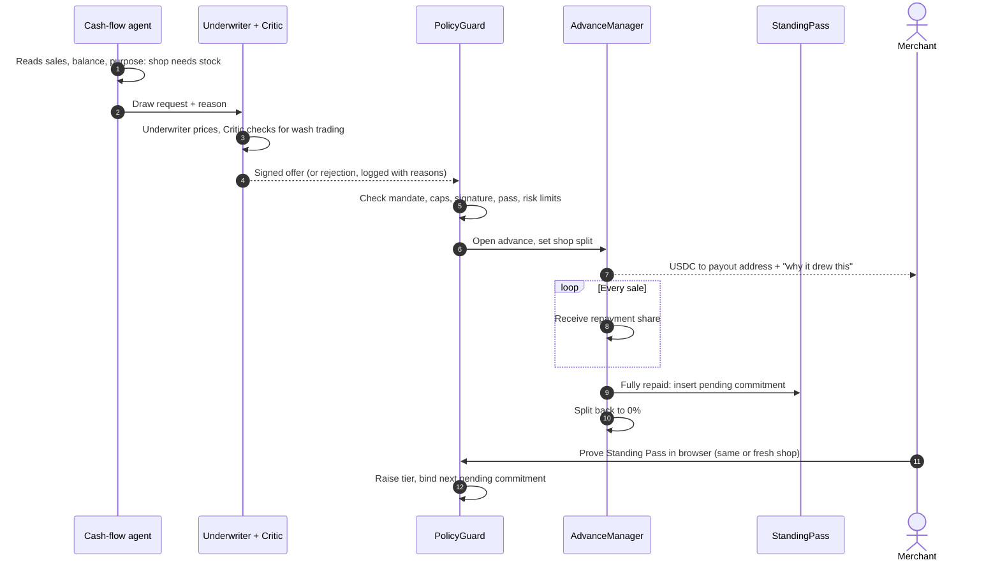

# Architecture

## System overview



## Components

### Contracts (Solidity, Foundry)

| Contract | Responsibility |
|---|---|
| `ShopRegistry` | Shop pseudonyms and their payout addresses. Creating a shop and rotating to a fresh one ("Start fresh shop") both go through it. Holds no identity. |
| `PaymentRouter` | Entry point for every sale. Looks up the shop's split (0% with no advance), sends the merchant share to the payout address and the repayment share to `AdvanceManager`. Emits `Sale(shopId, amount)`. |
| `AdvanceManager` | Tracks each advance: principal, fee, amount repaid, and a pending Standing Pass commitment. Distributes repayments across senior, junior and reserve. Marks write-offs. On full repayment, inserts the pending commitment into the `StandingPass` tree. |
| `PolicyGuard` | The final authority, checked on every draw. Stores each shop's **agent mandate** (max per advance, max per month, purpose, active, paused or revoked) set by the merchant's one-time Agent Pass approval. Enforces: the mandate, cap per tier, one active advance per shop, fixed advance sizes, a valid offer signature from the agent service, a valid Business Pass or Standing Pass, and the current risk limits. |
| `BusinessPass` | Verifies the zkTLS attestation (or a server-relayed attestation for the demo), records the public facts (country, revenue band, months active) against the shop, and stores a nullifier so one seller account can't onboard twice. |
| `StandingPass` | Incremental Merkle tree of credential commitments, a nullifier set, and the generated Noir verifier. |
| `SeniorVault` | ERC-4626 USDC vault for lenders. Funds advances and earns most of the fee. Takes losses only after junior and reserve run out. |
| `JuniorToken` | ERC-20 representing first-loss capital. Minted and redeemed against USDC. Earns a larger share of fees for its size. |
| `RiskHook` | Uniswap v4 hook on the junior/USDC pool. Routes a small fee to the reserve and exposes a time-averaged price (TWAP). |

### Off-chain

| Service | Responsibility |
|---|---|
| Merchant app (Next.js mobile web) | Onboarding, Business Pass, shop setup, agent setup and management, live sales, advance details, Standing Pass proving in the browser (Noir, bb.js), cash out, settings, backup and recovery. Shows local currency next to dollars. |
| Pay screen | QR target for customers. Takes the customer's token, swaps through the Uniswap API, calls `PaymentRouter.pay`. Never mentions the advance. |
| Lender and junior views | Same Next.js app. Senior vault earn, deposit, withdraw and position. Junior vault, mint, redeem and trade on the Uniswap pool. |
| Public dashboard | Protocol totals, risk status, explorer links. Hosts the data behind the "What the world sees" toggle. |
| Demo seller portal | A separate site with seeded seller accounts: login, balance, sales chart, transactions. The zkTLS proof reads from it. Stands in for Mercado Pago. |
| Agent service (TypeScript) | Cash-flow, Underwriter, Critic and Risk agents. Calls Claude with structured outputs, signs offers that pass the Critic. Holds an offer-signing key only, never funds. |
| API routes (Vercel) | Server-side validation of Agent Pass and World ID results and of zkTLS attestations, offer relay, gas sponsorship for the demo. |

## Onboarding



## Advance lifecycle



The first advance is backed by the Business Pass. Each later limit increase needs a Standing Pass proof made on the merchant's device. The proof spends the old credential and binds the next pending commitment, so the agent can draw again only after the merchant opens the app once. The merchant can send that proof for a **fresh shop**, which carries the reputation to a new pseudonym with no onchain link.

### Agent controls

- **Edit limits:** lowering takes effect immediately. Raising needs a new Agent Pass approval.
- **Pause:** no new draws. The active advance keeps repaying from sales.
- **Revoke:** the mandate is deleted. Setting up a new agent needs a new approval.

### Default path

If sales stop for the default window (for example 30 days with no sales, a parameter to tune), `AdvanceManager` writes the advance off. Losses hit junior first, then the reserve, then senior. The pending commitment is never inserted, so the merchant has no credential to spend. Their Business Pass nullifier is already used, and World allows one agent per human, so they can't start over with a new shop or wallet.

## Enforcement and its limits

Repayment is enforced only for sales that go through `PaymentRouter`. A merchant could hand customers a different address. To limit the damage:
- small first advances, with limits that grow only through repayment
- the Critic and Risk agents flag sudden sales drops
- the cash-flow agent can pay a supplier directly, so the money goes where the purpose says

## Chain and deployment

- **Chain:** Ethereum Sepolia, where Uniswap lists v4. Confirm addresses at the start.
- **Stablecoin:** Sepolia USDC if available, otherwise a mock token deployed by us.
- **Gas:** sponsored for the merchant and the demo customer. Nobody in the demo holds ETH.
- **RPC:** Anon-RPC is the default transport for every read in the app and the public dashboard.

## Repo layout (planned)

```
contracts/      Foundry project: shop registry, router, advance manager, policy guard, business pass, standing pass, vault, junior, hook
circuits/       Noir: standing_pass
agents/         TypeScript agent service: cash-flow, underwriter, critic, risk
app/            Next.js: merchant app, pay screen, lender and junior views, public dashboard, API routes
seller-portal/  Demo seller portal (separate site, stand-in for Mercado Pago)
docs/           You are here
```
