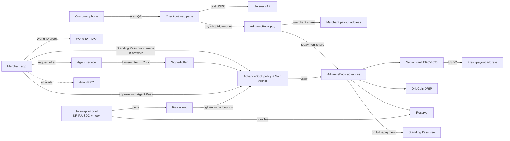

# Architecture

## System overview



## Components

### Contracts (Solidity, Foundry): built, see `contracts/SPEC.md`

Following the ethskills `ship` guideline (at most 3 custom contracts for an MVP), there are **2 custom contracts**. The vaults are standard OpenZeppelin ERC-4626, the verifier is generated by `bb`, and Poseidon2 is already deployed.

| Contract | Kind | Responsibility |
|---|---|---|
| `AdvanceBook` | custom | Everything about advances, in one contract, assembled from three modules: |
| ↳ `Policy` | module | EIP-712 agent offers, tier caps ($50/$100/$200/$300), exposure cap, risk limits (the Risk agent can only lower them, never below the floors) |
| ↳ `StandingPassTree` | module | Depth-16 Poseidon2 Merkle tree of credentials, every historical root accepted |
| ↳ core | | `pay` splits every sale (8% holdback while an advance is active); `drawFirst` (Business Pass proof), `drawWithPass` (Standing Pass proof) and `drawByMandate` (managed agent, after a one-time Agent Pass delegation) open advances; the 1%-per-7-days minimum repayment and late fee; fee and loss waterfalls; permissionless `repay` and `writeOff` (with bounty); `claimStandingPass` |
| `TrancheVault` ×2 | OpenZeppelin ERC-4626 | **Senior:** lends principal, earns 40% of fees, loses last. **Junior:** first-loss buffer, earns 30% of fees. **Its share token is DripCoin (DRIP)**, which trades on Uniswap. Junior must cover 20% of senior outstanding: draws revert below it, and junior withdrawals are limited by it. The reserve takes 20% of fees (plus all late fees) and the protocol 10%. |
| `RiskHook` | custom | Uniswap v4 hook on DRIP/USDC. Takes a 0.3% fee only when the swap's unspecified currency is USDC; `flush()` sends 75% to the reserve and 25% to the treasury. Records a 64-slot TWAP that the Risk agent reads instead of the spot price. |
| `HonkVerifier` | generated | `circuits/standing_pass/build.sh`, then `src/verifier/HonkVerifier.sol` (18KB, under the 24KB limit). Compiles as its own unit (solc ≥0.8.27). Never import it; use `IVerifier`. |
| Poseidon2 | existing | `0xB2542195Ad96AcfBC962C48A97D7640A9F5386D2` on Sepolia (zemse/poseidon2-evm). Verified against Noir. |

### Who calls what (ethskills: "nothing runs itself")

| Transition | Caller | Why they pay gas | If nobody calls |
|---|---|---|---|
| `pay(shopId, amount)` | Customer | Buying something | No sales, no repayment (by design) |
| `drawFirst` / `drawWithPass` | Merchant, **through a relayer or a fresh paymaster account** | Wants the cash | Nothing happens |
| `claimStandingPass(id)` | Merchant, through a relayer | Wants a higher limit next time | Credential waits, nothing lost |
| `writeOff(id)` | Anyone, 30 days after the last on-time repayment (the clock restarts each time the 1%-per-7-days minimum is met) | Bounty (5 USDC) from the reserve | DRIP stays overpriced. This is a risk; our keeper calls it as a backstop. |
| `repay(id, amount)` | Anyone | Pays down an advance directly (fee, then late fee, then principal) | — |
| `lowerLimits` | Risk agent key | Our job | Limits stay at the last value (safe) |
| `flush()` on `RiskHook` | Anyone (our keeper) | Tops up the reserve that pays bounties | Fees wait in the hook |
| Vault deposit / withdraw | Lenders | Their own money | — |

**Privacy rule (ethskills `noir`):** the draw functions never read `msg.sender`. The merchant must never send a draw from their usual wallet, because the public sender would link the advances that the ZK proof keeps apart. Use a relayer, or a fresh account whose gas a paymaster pays and which was never funded from the merchant's wallet.

### Operator powers (named for CROPS)

| Power | Held by | What it can do to users | If the key is lost |
|---|---|---|---|
| Offer signer | Agent service | Refuse new advances (censorship) | No new advances. Payments, repayment and withdrawals still work. |
| Risk manager | Risk agent | Lower limits only, never below the floors | Limits freeze at the current value |
| Owner (`Ownable2Step`) | Team multisig (a single key for the hackathon) | Raise limits, rotate the signer and risk manager | Same as above. It can't touch funds and there are no upgrades or pause. |

### Off-chain

| Service | Responsibility |
|---|---|
| Merchant app (Next.js mobile web) | Onboarding, offers, approvals, live sales, Standing Pass proving in the browser (Noir, bb.js). Shows local currency next to dollars. |
| Checkout page | QR target. Takes test USDC and calls `AdvanceBook.pay`; any-token swaps are planned. |
| Agent service (Python, `agents/`) | Underwriter, Critic and Risk agents, keeper and relayer. Calls the judge models (Bedrock: Mistral Large 3, Kimi K2.5, Qwen3; Claude is a drop-in) with structured outputs, and signs offers that pass the Critic. Holds an offer-signing key only, never funds. |
| API routes (Vercel) | Server-side World ID proof validation, offer relay, **relayer for draws and credential claims**, gas sponsorship for the demo. |
| Tree mirror (in the app) | Rebuilds the Standing Pass tree from `LeafInserted` events to produce Merkle paths. It must be **fixed depth 16, padded with zeros, using Poseidon2 from `@aztec/bb.js`**. Not `@zk-kit/lean-imt`, whose roots differ. |

## Advance lifecycle

```mermaid
sequenceDiagram
  autonumber
  actor M as Merchant
  participant App as Merchant app
  participant W as World ID
  participant A as Agents
  participant R as Relayer
  participant AB as AdvanceBook

  M->>App: Start onboarding
  App->>W: World ID first: prove unique human (IDKit)
  W-->>App: Proof (backend keeps only an HMAC; banned or open advance → stop screen)
  alt First advance
    App->>App: zkTLS → Business Pass; prove it in the browser
  else Returning merchant
    App->>App: Prove in browser: own credential in tree with count k
    Note over App: Outputs nullifier, tier k, new commitment for k+1
  end
  App->>A: Shop ID + proven tier (no personal data)
  A->>A: Underwriter drafts offer, Critic reviews
  A-->>App: Signed offer, or rejection with reason
  M->>App: Delegate once (World Agent Pass) → registerMandate
  App->>R: Signed offer (later draws: the agent requests offers itself)
  R->>AB: drawFirst / drawWithPass / drawByMandate
  AB->>AB: Check offer, caps, root, nullifier, proof, risk limits
  AB-->>M: Senior vault lends USDC to the fresh payout address
  loop Every sale (customer calls pay)
    AB->>AB: 8% holdback → fee split 40/30/20/10, late fee → reserve, then principal → senior
  end
  AB->>AB: Fully repaid: split back to 0%
  R->>AB: claimStandingPass: insert new commitment into the tree
```

### Default path

A merchant must repay at least 1% of owed per 7 days. While behind, a late fee accrues (an extra 0.5% per week, capped at 3%, 100% to the reserve). If the minimum isn't met for the default window (30 days, a parameter), **anyone** can call `writeOff` and earn a bounty from the reserve. Losses hit junior (DRIP) first, then the reserve, then senior. The pending commitment is never inserted, so the merchant has no credential to spend. The human behind the shop is banned by our offer signer (a private HMAC list), so their next attempt stops at the World ID step. Nothing about the person goes onchain.

## Enforcement and its limits

Repayment is enforced only for sales that go through `AdvanceBook.pay`. A merchant could hand customers a different address. To limit the damage:
- small first advances, with limits that grow only through repayment
- the 1%-per-7-days minimum repayment, the late fee and the 30-day write-off, whatever the QR sales
- the World ID ban after a write-off
- the Critic and Risk agents flag sudden sales drops
- (optional, not a prize track) an ENS shop name that stays locked to the router during an advance, so customers paying by name always trigger repayment

## Chain and deployment

- **Chain:** Ethereum Sepolia, where Uniswap lists v4. Confirm addresses at the start.
- **Stablecoin:** Sepolia USDC if available, otherwise a mock token deployed by us.
- **Gas:** sponsored for the merchant and the demo customer. Nobody in the demo holds ETH.
- **RPC:** Anon-RPC is the default transport for every read in the app.
- **Costs, measured live 2026-11-05 on mainnet (0.07 gwei, ETH $2,414) for comparison:**
  - a sale: about 90k gas, about $0.015
  - a credential insert: about 372k gas, about $0.06 (16 Poseidon2 calls at about 20k gas each)
  - a draw with proof verification: **3.09M gas measured** (2.8M of it is the verifier), about $0.52
- **Production chain** (pitch, not the hackathon): pick by distribution, not by fees. MiniPay on Celo for Africa, World Chain for Argentina.

## Repo layout

```
contracts/      Foundry project (built): AdvanceBook (+ Policy, StandingPassTree), TrancheVault, RiskHook, tests, deploy script
circuits/       Noir: standing_pass
agents/         Python agent service (FastAPI): features, judges, clamp, signer, relayer, risk, keeper
apps/web/       (frontend team) Next.js screens; talk to the backend only through packages/sdk
docs/           You are here
```
